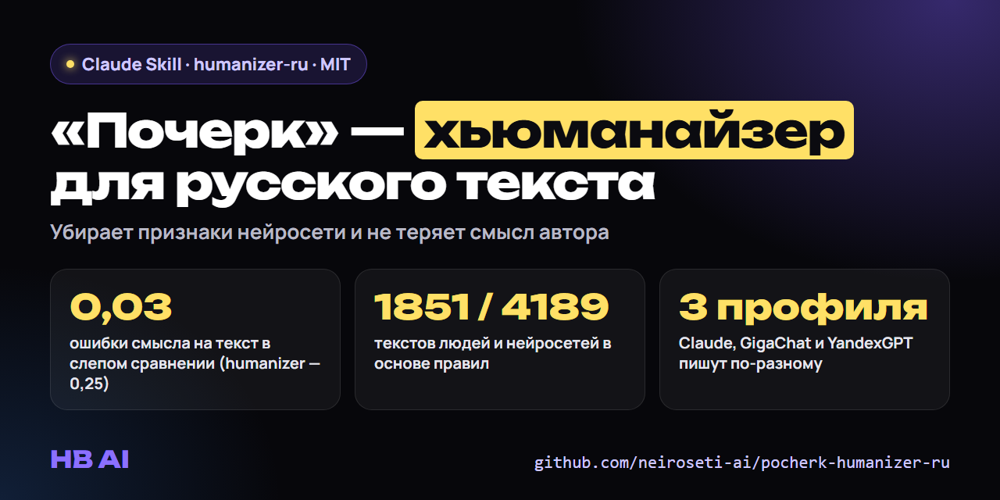

# Почерк — хьюманайзер для русского текста (Claude Skill · humanizer-ru)



[](LICENSE)   [](https://github.com/neiroseti-ai/pocherk-humanizer-ru/releases/latest)

**Как убрать признаки нейросети из русского текста и не потерять смысл.** «Почерк» — бесплатный скилл для Claude Code (формат Agent Skills, `SKILL.md`). Он переписывает текст ChatGPT, Claude, GigaChat или YandexGPT так, чтобы ушла машинная подача — рекламная рамка, эмодзи-списки, мораль в конце, двоеточия-ярлыки, «Таким образом», канцелярит, — а **факты, числа и мнение автора остались на месте**. Скрипт проверки это контролирует.

**Чем отличается от других хьюманайзеров — в одном абзаце.** За скиллом стоит исследование: 1851 текст людей против 4189 текстов шести нейросетей и слепое сравнение с популярными скиллами humanizer, humanizer-ru, slopotron и простой просьбой «перепиши как человек». В этом сравнении «Почерк» терял смысл реже всех: 0,03 ошибки на текст против 0,12–0,85 у остальных. Подробности и честные оговорки — [ниже](#сравнение-с-другими-хьюманайзерами).

*English: a research-backed Russian AI humanizer skill for Claude Code. Rules are measured on 1,851 human vs 4,189 AI texts; in a blind comparison with humanizer, humanizer-ru and slopotron it had the fewest meaning errors (0.03 per text vs 0.12–0.85).*

Сделано в сообществе [«Нейросети и AI на практике»](https://vk.com/neiroseti_ai) (HB AI).

**Подходит, если нужно:** сделать текст нейросети «человечным», почистить пост от ИИ-почерка, собрать пост из диктовки автора без отсебятины, отредактировать статью, рассылку или описание товара, написанные с помощью ИИ.

## На чём основан

Правила выведены не «на глаз», а из замеров:
- **1851 текст людей**, написанных до конца 2022 года (до массового ИИ);
- **4189 текстов шести моделей** на те же темы: Claude, GigaChat, YandexGPT, Алиса и другие;
- **974 правки человеческих текстов**, которые сделали четыре из этих моделей;
- **два раунда слепой оценки**: судья не знал, где человек, а где модель.

Что из этого следует (подробно — в начале [SKILL.md](pocherk/SKILL.md)):
- **Главный рычаг — не давать модели «улучшать» человеческий текст.** Когда Claude Opus правит пост человека «чтобы читался лучше», слепой судья снимает с него 25 пунктов из 100 (с 83 до 58).
- **Второй рычаг — снять рекламную рамку.** У коротких постов GigaChat снятие эмодзи, «!», восторгов и вопроса-приманки подняло оценку на 19 пунктов.
- **У разных моделей разный почерк.** У Claude выдают ритм без длинных фраз, двоеточия-раскрытия и тире-повороты, а канцелярита у него меньше, чем у людей. У GigaChat наоборот: «Таким образом», «однако», деепричастные хвосты. Поэтому правила разделены по профилям — `claude`, `gigachat`, `yandex`.

**Честно о пределах.** Скилл не делает текст неотличимым от человеческого: ни один способ правки в наших тестах до людей не дотянул, слепой судья по-прежнему узнаёт модель. Живость даёт содержание автора — его детали, мнения, примеры. Скилл убирает машинную подачу и следит, чтобы при этом не пропали факты, оценки и выводы автора.

## Сравнение с другими хьюманайзерами

Слепой замер 05.10.2026. 36 черновиков нейросетей (24 Claude Opus, 12 GigaChat) переписали шестью способами, все правки делал Claude Opus 5.5. Потом проверили, сколько слов поменялось и сколько пунктов смысла потерялось или исказилось.

| Способ | Изменено слов в тексте (медиана) | Потерь смысла на текст |
|---|---|---|
| Простая просьба «перепиши, чтобы звучало как человек» | 86,5 | 0,85 |
| zhivoy-tekst (наш прошлый скилл) | 52,5 | 0,28 |
| humanizer | 48,5 | 0,25 |
| slopotron | 33,5 | 0,28 |
| humanizer-ru | 12,5 | 0,12 |
| **Почерк** (версия v3) | **5** | **0,03** |

Что важно знать про эту таблицу:
- «Почерк» ошибается реже других в первую очередь потому, что меньше всех правит. При одинаковом объёме правки разница с остальными не доказана.
- По «похожести на человека» в этом раунде ни один скилл, включая наш, не обошёл простую просьбу. Слепой судья отличает от людей тексты после любого способа.
- Слабое место v3 было в том, что рекламный черновик с эмодзи оставался рекламным. В текущей версии добавлено снятие рекламной рамки: в замере у коротких постов GigaChat её снятие подняло оценку судьи на 19 пунктов.

Почему подход другой:
- **Правила измерены на русском, а не переведены с английского.** Многие русские списки «примет ИИ» переведены с английских, а у разных моделей почерк разный. «Однако» Claude пишет втрое реже людей, а GigaChat вчетверо чаще. Общий список заставит чинить у Claude то, чего у него нет. Поэтому в «Почерке» отдельные профили `claude`, `gigachat`, `yandex`.
- **Скилл знает, где правка вредит.** В замере Claude Opus «улучшил» 24 поста людей, и слепой судья снял с них 25 баллов из 100. «Почерк» не переписывает человеческий текст ради гладкости.
- **Смысл проверяет скрипт, а не обещание.** `check.py` сверяет числа, имена, модальность («надо», «можно»), оценки и выводы автора с исходником.

## Что умеет

- **`rewrite`** — переписать черновик нейросети;
- **`edit`** — осторожно поправить текст, написанный человеком (только явные ошибки и подача модели);
- **`write`** — написать текст по брифу или собрать пост из диктовки автора, не досочиняя за него;
- **проверка скриптом** `scripts/check.py`: факты и числа не потерялись, мнение не превратилось в факт, не добавлено лишнее, маркеры в норме жанра.

## Установка

Скачайте архив из [последнего релиза](https://github.com/neiroseti-ai/pocherk-humanizer-ru/releases/latest) или клонируйте репозиторий и скопируйте папку `pocherk` в папку скиллов Claude Code:

- для всех проектов: `~/.claude/skills/pocherk` (в Windows — `C:\Users\<имя>\.claude\skills\pocherk`);
- для одного проекта: `<проект>/.claude/skills/pocherk`.

После этого Claude сам подключит скилл, когда вы попросите «перепиши, чтобы не звучало как нейросеть», «почисти от ИИ», «собери пост из моей диктовки».

Для скрипта проверки нужен Python 3.10+. Работает и без сторонних библиотек, но точнее с ними — они лучше делят текст на фразы и узнают формы слов:

```
pip install razdel pymorphy3
```

## Проверка текста скриптом

```
python pocherk/scripts/check.py --source источник.txt --draft черновик.txt --result результат.txt --mode rewrite --profile gigachat --genre post
```

Скрипт выдаёт отчёт по блокам: факт-замок (числа, имена, модальность), след ИИ-правки, бюджеты маркеров, ритм, провенанс (чьи это фразы) и подача. Пример с разбором — в папке [examples](examples/).

## Голос автора

Если тексты собираются из диктовки конкретного человека, заведите карточку его голоса по шаблону [`references/voice_template.md`](pocherk/references/voice_template.md) и сохраните как `references/voice.md`.

## Состав

```
pocherk/
  SKILL.md                     — сам скилл: шаги правки, профили моделей, что нельзя трогать и вставлять
  references/markers.md        — каталог маркеров с примерами и данными
  references/voice_template.md — шаблон карточки голоса автора
  scripts/check.py             — самопроверка результата
  scripts/textkit.py           — разбор текста на фразы и слова
  scripts/budgets.json         — нормы маркеров по жанрам, посчитанные на корпусе людей
  scripts/tests/               — тесты (python -m pytest pocherk/scripts/tests)
examples/                      — пример правки с выводом скрипта
```

Корпус текстов в репозиторий не входит: в нём чужие тексты.

## Частые вопросы

**Как убрать признаки ИИ из текста?**
Установите скилл и попросите Claude: «перепиши, чтобы не звучало как нейросеть» или «почисти от ИИ». Скилл снимет машинную подачу по правилам для модели, которая писала черновик, а скрипт проверит, что факты и смысл не пострадали.

**Это обход детекторов ИИ?**
Нет, и обещать такого мы не будем. Скилл про качество текста для читателя, а не про обман детекторов. В наших тестах даже правленый текст слепой судья отличал от человеческого.

**Чем лучше humanizer и других хьюманайзеров?**
Мы проверили это замером, а не на глаз. В слепом сравнении на 36 черновиках «Почерк» терял смысл реже всех: 0,03 ошибки на текст, у humanizer-ru 0,12, у humanizer 0,25, у простой просьбы 0,85. Правила выведены из 1851 текста людей и 4189 текстов нейросетей на русском, у Claude, GigaChat и YandexGPT отдельные профили. Подробности и оговорки — в разделе [«Сравнение с другими хьюманайзерами»](#сравнение-с-другими-хьюманайзерами).

**Работает ли с текстами GigaChat и YandexGPT?**
Да, для них свои профили правил. Сама правка выполняется в Claude.

**Что нужно для работы?**
Claude Code или другой агент, который поддерживает формат Agent Skills, и Python 3.10+ для скрипта проверки. Сам скилл бесплатный.

## In English

**Pocherk** (Russian for "handwriting") is a free **AI humanizer for Russian text**, packaged as an Agent Skill for Claude Code (`SKILL.md`). It rewrites drafts from ChatGPT, Claude, GigaChat or YandexGPT to remove AI writing patterns — promo framing, emoji lists, moralizing endings, label colons, bureaucratic connectors — while keeping facts, numbers and the author's opinions intact.

- **Blind comparison:** on 36 AI drafts rewritten by six methods, pocherk had the fewest meaning errors: 0.03 per text vs 0.12 (humanizer-ru), 0.25 (humanizer), 0.28 (slopotron) and 0.85 (plain "make it sound human" prompt). Caveat: mostly because it edits the least; on human-likeness no skill beat the plain prompt.
- **Data-driven rules:** 1,851 human texts written before the end of 2022 vs 4,189 texts from six models, plus 974 model edits of human texts, validated in two rounds of blind evaluation.
- **Model profiles:** separate rules for Claude, GigaChat and YandexGPT — their Russian "handwriting" is almost opposite.
- **Checker:** `scripts/check.py` verifies that numbers, names, modality and opinions survived the edit (optional deps: `razdel`, `pymorphy3`).
- **Honest limits:** it improves text for readers; it is not a tool for bypassing AI detectors.

Install: copy the `pocherk` folder to `~/.claude/skills/`. MIT license.

## Лицензия

[MIT](LICENSE). © 2026 HB AI, [vk.com/neiroseti_ai](https://vk.com/neiroseti_ai)
